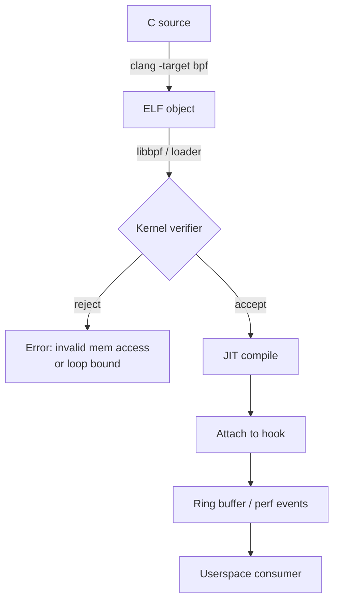

The first time you attach an eBPF program to a running kernel, the thing that surprises you is not the speed. It is the silence: no module reload, no reboot, no `dmesg` full of warnings. You compile a C function, hand it to the kernel, and it starts answering questions about syscalls that were already running.

That is a genuine architectural change. Before eBPF, "observe syscall latency on a production host" meant one of: a kernel module (reboot, risk, review), `strace` (brutal overhead), or `perf` (sampling, not per-event). eBPF gives you per-event logic with bounded, verified safety.

## The contract: a verifier, not a compiler

An eBPF program is bytecode for a virtual RISC machine with 11 registers and a 512-byte stack. Before anything runs, the kernel's verifier proves four properties:



The verifier is why eBPF is safe to hand to operators, and also why your first ten programs fail to load. Every pointer access must be provably in-bounds, every loop must have a statically bounded trip count, and every helper call must be legal for the program type.

## A first program that earns its keep

Counting `openat` calls per process, without touching the target:

```c
// open_count.bpf.c
#include <linux/bpf.h>
#include <bpf/bpf_helpers.h>

struct {
    __uint(type, BPF_MAP_TYPE_HASH);
    __uint(max_entries, 1024);
    __type(key, __u32);      // pid
    __type(value, __u64);    // count
} counts SEC(".maps");

SEC("tracepoint/syscalls/sys_enter_openat")
int count_openat(struct trace_event_raw_sys_enter *ctx)
{
    __u32 pid = bpf_get_current_pid_tgid() >> 32;
    __u64 *value = bpf_map_lookup_elem(&counts, &pid);
    if (value) {
        __sync_fetch_and_add(value, 1);
    } else {
        __u64 one = 1;
        bpf_map_update_elem(&counts, &pid, &one, BPF_NOEXIST);
    }
    return 0;
}

char LICENSE[] SEC("license") = "GPL";
```

Three things to notice:

- `bpf_get_current_pid_tgid() >> 32` is the pid; the low half is the tid. Getting this backwards is a rite of passage.
- The map is the only way out. Programs cannot print, allocate, or block.
- `SEC("tracepoint/...")` is the attach contract, resolved by libbpf at load time.

Userspace reads the map with `bpf_map_lookup_elem` via `libbpf`, or — much nicer — with a `BPF_MAP_TYPE_RINGBUF` and events pushed from the program.

## Per-event latency, the thing sampling cannot do

The canonical demonstration: a histogram of block I/O latency. Sampling gives you an average; eBPF gives you the shape of the tail, including the 40 ms stalls hiding behind a healthy p50.

```c
struct {
    __uint(type, BPF_MAP_TYPE_HASH);
    __uint(max_entries, 1024);
    __type(key, __u64);   // start timestamp, keyed by request pointer
    __type(value, __u64);
} starts SEC(".maps");

struct {
    __uint(type, BPF_MAP_TYPE_HISTOGRAM);  // logical; use ARRAY + log2 bucketing in practice
    __uint(max_entries, 64);
    __type(key, __u32);
    __type(value, __u64);
} latency SEC(".maps");

SEC("kprobe/blk_account_io_start")
int on_io_start(struct pt_regs *ctx)
{
    __u64 key = (__u64)PT_REGS_PARM1(ctx);
    __u64 ts = bpf_ktime_get_ns();
    bpf_map_update_elem(&starts, &key, &ts, BPF_ANY);
    return 0;
}

SEC("kprobe/blk_account_io_done")
int on_io_done(struct pt_regs *ctx)
{
    __u64 key = (__u64)PT_REGS_PARM1(ctx);
    __u64 *start = bpf_map_lookup_elem(&starts, &key);
    if (!start) return 0;

    __u64 delta = bpf_ktime_get_ns() - *start;
    bpf_map_delete_elem(&starts, &key);

    __u32 bucket = 0;
    while (delta > 1 && bucket < 63) { delta >>= 1; bucket++; }
    __u64 *slot = bpf_map_lookup_elem(&latency, &bucket);
    if (slot) __sync_fetch_and_add(slot, 1);
    return 0;
}
```

The log2 bucketing is what turns an unbounded measurement into a bounded, verifier-friendly one. Power-of-two buckets are coarse, but the tail shape is exactly what you needed.

## What to attach to

| Program type | Attaches to | Use for |
| --- | --- | --- |
| `kprobe` / `kretprobe` | Any kernel symbol | Debugging, discovery |
| `tracepoint` | Stable kernel tracepoints | Production telemetry |
| `fentry` / `fexit` | BTF-typed functions | Low overhead, typed args |
| `xdp` | Driver receive path | Packet filtering before the stack |
| `tc` | Traffic control | Shaping, forwarding |
| `cgroup/*` | A cgroup | Per-container policy |
| `lsm` | LSM hooks | Security enforcement |

Prefer `fentry` and tracepoints over kprobes in production: symbol names are unstable, and a kprobe on an inlined function silently attaches to the wrong place.

## The costs nobody mentions

- **Verifier failures are a compiler error class of their own.** `invalid mem access 'scalar'` usually means you forgot a bounds check, not that the kernel is wrong.
- **Map lookups are atomics.** A histogram updated on every packet is a contention point; per-CPU maps exist for this reason.
- **Ring buffer backpressure is your problem.** If userspace stalls, events are dropped, and dropped events are invisible unless you count them.
- **BTF is not optional anymore.** CO-RE (`vmlinux.h`, `BPF_CORE_READ`) is the difference between "works on my kernel" and "works on the fleet".
- **You can absolutely take down a host.** A program attached to a hot path with an expensive loop is a denial of service you wrote yourself. Test with `bpftool prog load ... dry_run` and a canary.

## Where this changes your instincts

Once you can ask the kernel a question per event, the shape of debugging changes. Instead of "add a log line and redeploy", it becomes "attach for thirty seconds and look at the distribution". That is a faster loop than almost anything else in systems work, and it is available on the machine that is already broken.

- [x] Attach a tracepoint counter with `bpftool`
- [x] Replace one `strace` session with an eBPF one-liner
- [ ] Write a CO-RE program that survives a kernel upgrade
- [ ] Measure the overhead of your own program on `p99` syscall latency
