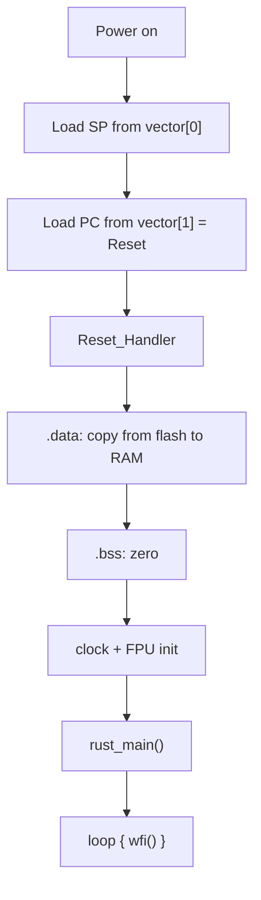

On a desktop, `main` is a courtesy. Something else has already configured memory, set up a stack, and arranged for your code to exist at an address the CPU will jump to. On a Cortex-M microcontroller, that something else is you.

I spent a weekend writing the minimum viable runtime for an STM32F4 in `#![no_std]` Rust. It came to about 300 lines, and every one of them taught me something the abstraction had been hiding.

## The boot sequence, without the vendor



Two facts explain nearly all of it:

1. The CPU reads the initial stack pointer from address `0x0000_0000` and the reset vector from `0x0000_0004`. No firmware does this for you; the silicon does.
2. Until you copy `.data` and zero `.bss`, no global with a non-zero initialiser exists — including your own runtime's state.

## The linker script is the program's shape

```ld
MEMORY
{
  FLASH (rx)  : ORIGIN = 0x08000000, LENGTH = 1024K
  RAM   (rwx) : ORIGIN = 0x20000000, LENGTH = 128K
}

ENTRY(Reset_Handler)

SECTIONS
{
  .vector_table ORIGIN(FLASH) :
  {
    KEEP(*(.vector_table));
  } > FLASH

  .text : { *(.text .text.*) } > FLASH
  .rodata : { *(.rodata .rodata.*) } > FLASH

  .data : ALIGN(4)
  {
    _sdata = .;
    *(.data .data.*);
    _edata = .;
  } > RAM AT > FLASH
  _sidata = LOADADDR(.data);

  .bss : ALIGN(4)
  {
    _sbss = .;
    *(.bss .bss.* COMMON);
    _ebss = .;
  } > RAM

  _estack = ORIGIN(RAM) + LENGTH(RAM);
}
```

`> RAM AT > FLASH` is the whole trick: the section is *linked* at a RAM address but *stored* in flash, so the reset handler knows it has to copy it. Forget that, and every initialised static is garbage.

## Reset handler, in Rust

```rust
#![no_std]
#![no_main]

use core::ptr;

extern "C" {
    static mut _sidata: u32;  // .data load address in flash
    static mut _sdata: u32;   // .data start in RAM
    static mut _edata: u32;   // .data end in RAM
    static mut _sbss: u32;    // .bss start
    static mut _ebss: u32;    // .bss end
}

#[no_mangle]
pub unsafe extern "C" fn Reset() -> ! {
    // 1. copy .data from flash to RAM
    let mut src = &raw const _sidata as *const u32;
    let mut dst = &raw mut _sdata as *mut u32;
    while dst < (&raw mut _edata as *mut u32) {
        ptr::write_volatile(dst, ptr::read_volatile(src));
        dst = dst.add(1);
        src = src.add(1);
    }

    // 2. zero .bss
    let mut bss = &raw mut _sbss as *mut u32;
    while bss < (&raw mut _ebss as *mut u32) {
        ptr::write_volatile(bss, 0);
        bss = bss.add(1);
    }

    // 3. FPU: enable CP10/CP11 before any float operation
    const CPACR: *mut u32 = 0xE000_ED88 as *mut u32;
    ptr::write_volatile(CPACR, ptr::read_volatile(CPACR) | (0b1111 << 20));

    main()
}
```

The FPU step is the one that produces the most confusing failure mode: touch a `f32` before enabling CP10/CP11 and the core takes a `HardFault` with no useful message.

## A vector table you can read

```rust
#[repr(C)]
pub struct VectorTable {
    pub initial_sp: u32,
    pub reset: unsafe extern "C" fn() -> !,
    pub nmi: unsafe extern "C" fn(),
    pub hard_fault: unsafe extern "C" fn(),
    // ... 12 more system exceptions, then IRQs
}

#[link_section = ".vector_table"]
#[no_mangle]
pub static VECTORS: VectorTable = VectorTable {
    initial_sp: 0x2002_0000,   // top of 128K RAM
    reset: Reset,
    nmi: DefaultHandler,
    hard_fault: HardFault,
};
```

Keeping the table in Rust instead of assembly costs 40 bytes and makes the interrupt wiring inspectable by the compiler and by `objdump`.

## What `no_std` actually takes away

| You lose | You keep | You must provide |
| --- | --- | --- |
| `alloc` (unless you add an allocator) | `core`, iterators, `Option` | Panic handler |
| Threads, `Mutex` | Atomics on Cortex-M3+ | Critical sections |
| `println!` | `write!` via `core::fmt::Write` | A UART or RTT channel |
| Stack overflow protection | Bounds-checked slices | Optionally an MPU region guard |

A panic handler is mandatory, and it should be useful:

```rust
#[panic_handler]
fn panic(info: &core::panic::PanicInfo) -> ! {
    // Write to a memory-mapped debug register, then halt with interrupts off.
    let msg = info.message();
    let _ = write_rtt(format_args!("PANIC: {msg}\r\n"));
    loop {
        cortex_m::asm::udf();   // halt in debugger
    }
}
```

## The part I did not expect

Writing `_start` by hand changes how you read embedded code. A vendor HAL stops being magic and becomes a set of decisions you can audit: which clocks are enabled, which interrupts are unmasked, what the linker actually placed where.

Also, 300 lines of runtime is small enough to keep in your head. That is a rare and pleasant property in systems software.

- [x] Boot with a hand-written vector table
- [x] Prove `.data` copy works with a `static mut` sentinel
- [x] Get a `HardFault` handler that prints the stacked PC
- [ ] Add an MPU guard page below the stack and catch overflow
- [ ] Replace the busy-wait UART with DMA
