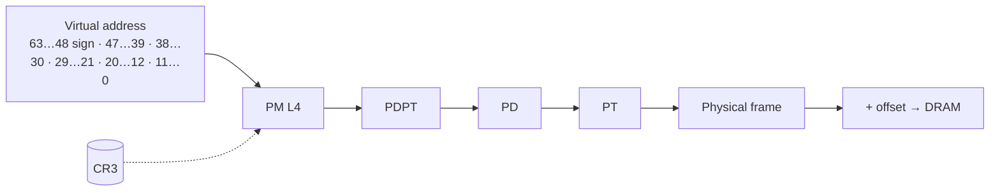

Every introduction to memory management stops at the same place: the stack grows down, the heap grows up, and `malloc` is magic. That model survives right up until you watch a process spend forty seconds faulting in two hundred pages, or a memcpy run three times slower on the second machine for no visible reason.

The gap between "stack and heap" and how a machine actually behaves is almost entirely about one thing: **address translation is a cache hierarchy, and you are not in control of it.**

## Three addresses, one pointer

There are three different things people call "the address of `x`":

1. The **virtual address** your pointer holds. This is the only one your code ever sees.
2. The **physical address** the DRAM controller sees, after the MMU translates.
3. The **offset inside a page**, which is never translated at all.

x86-64 in long mode uses 48-bit virtual addresses (57 with 5-level paging), split into 4 KiB pages by default. The low 12 bits pass through untouched; the upper 36 bits are resolved by walking a radix tree.



Each level indexes 512 entries of 8 bytes, which is exactly one 4 KiB page of page tables. A single level-4 table covers 512 × 512 GiB = 256 TiB of address space, which is why nobody allocates the full tree.

### What a flat table would cost

If translation were a flat array, one entry per 4 KiB page:

$$
N_{\text{entries}} = \frac{2^{48}}{2^{12}} = 2^{36}, \qquad
\text{size} = 2^{36} \times 8\ \text{B} = 512\ \text{GiB}
$$

Per process. That number is the entire reason page tables are sparse trees: a process that maps 40 MiB pays for a handful of tables, not half a terabyte.

## A page fault you can measure

Most "faults" are not errors. They are the kernel lazily materialising a mapping you already asked for. Here is a 20-line program that makes the cost visible:

```c
#include <stdio.h>
#include <stdlib.h>
#include <sys/mman.h>
#include <sys/resource.h>
#include <time.h>

static double now_ms(void) {
    struct timespec ts;
    clock_gettime(CLOCK_MONOTONIC, &ts);
    return ts.tv_sec * 1e3 + ts.tv_nsec / 1e6;
}

int main(void) {
    const size_t len = 1UL << 30;  // 1 GiB
    char *p = mmap(NULL, len, PROT_READ | PROT_WRITE,
                   MAP_PRIVATE | MAP_ANONYMOUS | MAP_NORESERVE, -1, 0);
    if (p == MAP_FAILED) { perror("mmap"); return 1; }

    double t0 = now_ms();
    for (size_t i = 0; i < len; i += 4096) p[i] = 1;   // one touch per page
    double t1 = now_ms();

    struct rusage ru;
    getrusage(RUSAGE_SELF, &ru);
    printf("touched %zu pages in %.1f ms (%.2f µs/page)\n",
           len / 4096, t1 - t0, (t1 - t0) * 1000 / (len / 4096));
    printf("minor faults: %ld\n", ru.ru_minflt);
    return 0;
}
```

On a warm desktop this prints roughly `0.5–1.5 µs/page`: that is the cost of a minor fault — trap, find a free frame, zero it, install a PTE, return. 1 GiB of freshly mapped anonymous memory is not "allocated" until that loop runs.

> `MAP_NORESERVE` does not make the memory free. It only tells the kernel not to pre-commit swap. The frames are still allocated on first touch, and `zero`ing them is real work.

### Major versus minor

| Fault type | What the kernel does | Typical cost |
| --- | --- | --- |
| Minor (anonymous) | Allocates a zeroed frame, installs PTE | ~1 µs |
| Minor (file-backed, cached) | Maps an existing page-cache page | ~1 µs |
| Major | Reads from disk / SSD into page cache | 50 µs – 10 ms |
| Protection | Delivers SIGSEGV or COW copy | ~2–20 µs |

The 40× "why is this slow" moments almost always live in the third row.

## The TLB is the real cache

Translation is not free, so the CPU caches it. The TLB holds recently used virtual→physical mappings, and it is small: typically 64 L1 dTLB entries and 1,500–2,000 L2 entries on modern x86.

That means a program that walks a large array sequentially is doing fine — one translation per 4 KiB — while a pointer-chasing structure over a gigabyte can miss the TLB on nearly every access, and each miss costs a page walk of up to four dependent memory reads.

```c
// Sequential: ~1 TLB miss per 1024 int accesses
for (size_t i = 0; i < n; i++) sum += a[i];

// Pointer chase across a large graph: a TLB miss per hop
while (node) { sum += node->value; node = node->next; }
```

This is why huge pages matter. A 2 MiB page collapses 512 TLB entries into one, and the same workload goes from thrashing to comfortable without touching the algorithm.

### Order-of-magnitude latencies

Useful to keep in your head; exact numbers move every generation.

| Access | Approx. latency |
| --- | --- |
| L1d hit | ~1 ns |
| L2 hit | ~4 ns |
| L3 hit | ~15 ns |
| TLB miss + page walk (cached tables) | ~20 ns |
| TLB miss + page walk (DRAM tables) | ~100 ns |
| DRAM | ~80–120 ns |
| NVMe random read | ~80 µs |
| Same-datacentre RTT | ~500 µs |

Anything above DRAM in that table is a different universe. Design accordingly.

## Where the abstraction leaks

Four places worth knowing before you debug a "memory leak" that is not a leak:

1. **RSS is not your allocation.** Pages shared with the page cache, COW pages and huge pages all distort the number. `smaps_rollup` is more honest than `top`.
2. **Transparent huge pages change the failure mode.** A 2 MiB page that must be zeroed makes an allocation stall for hundreds of microseconds — visible as tail latency, invisible in averages.
3. **NUMA exists.** On a two-socket box the first touch decides which node owns the page. A thread on socket 0 reading memory allocated by socket 1 pays roughly 1.5–2× the latency, forever.
4. **`mlock` is a promise you cannot always keep.** It fails under memory pressure, and it is capped by `RLIMIT_MEMLOCK` unless you are root.

```bash
# The three commands that answer most memory questions
cat /proc/self/smaps_rollup
grep -E 'AnonHugePages|Unevictable' /proc/self/status
numastat -p $$
```

## What I take from all this

- Treat the first touch of a page as a real cost, because it is one.
- Measure faults, not just time. `perf stat -e page-faults,minor-faults` is one command.
- Prefer sequential access not because "cache is fast" but because it amortises translation.
- When a benchmark is inexplicably 3× off, check page size, NUMA placement, and whether you are actually measuring the disk.

- [x] Reproduce the fault cost on your own machine
- [x] Compare 4 KiB vs 2 MiB pages for a large array scan
- [ ] Repeat on a NUMA box and watch the remote-access penalty
