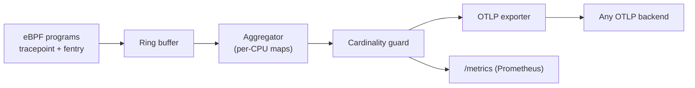

`lumen` is an observability agent that runs as one process on a Linux host and answers three questions without a control plane: what is this process waiting on, what is it reading, and what is it spending.

The design constraint was aggressive: under 15 MB of resident memory, no runtime dependencies beyond libc, and a configuration file a human can read in under a minute.

## What it collects

- **Scheduler latency** — run-queue delay per cgroup, from `sched_switch` tracepoints.
- **Block I/O latency** — a log2 histogram per device, so the tail is visible.
- **Syscall profile** — top-N syscalls by time, sampled, with `openat` paths aggregated.
- **TCP retransmits** — from `tcp_retransmit_skb`, not from a counter scrape.
- **Per-process RSS and page faults** — read from `smaps_rollup` at a configurable interval.

## Architecture

The cardinality guard is the part that matters in production: process names become labels, and a host that spawns a thousand short-lived containers will happily produce a hundred thousand series. `lumen` caps labels per metric and reports what it dropped.

## Status

Running on four machines, including the one serving this site. The syscall profiler is stable; the TCP path still misses connections that close inside the sampling window.

- [x] Ring-buffer backpressure handling
- [x] OTLP/gRPC exporter
- [x] Prometheus scrape endpoint
- [ ] Userspace symbolisation for kernel stacks
- [ ] Windows support (probably never; eBPF is the point)
