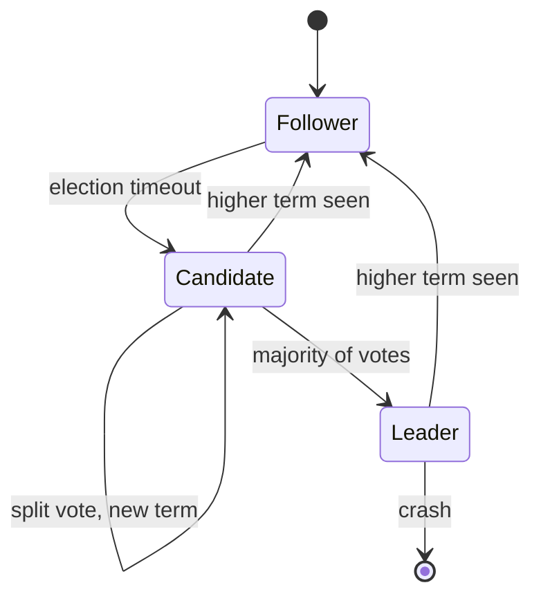

Raft is often described as "Paxos, but understandable". That is true in the same way that a bicycle is an understandable motorcycle: the concept is simpler, but the thing still falls over when you take a corner too fast.

I have implemented Raft three times — once badly, once for a course, and once for a key-value store that handled real traffic. This is a map of the parts that the paper compresses into a sentence and that cost me days.

## The state machine nobody draws

Every node is in exactly one of three states, and the transitions are only legal in one direction per term.



The subtle part is not the diagram. It is that **a single term contains at most one leader**, and every message you send must carry your term so a stale leader can be demoted immediately.

## Elections are a timing argument, not a correctness one

Raft's liveness depends entirely on randomised election timeouts being larger than the heartbeat interval, and on the network eventually delivering messages. If your timeout is 150 ms and your p99 GC pause is 400 ms, you will hold elections you did not want, and the cluster will spend its life re-electing.

```go
func (r *Raft) runElection() {
    r.mu.Lock()
    r.state = Candidate
    r.currentTerm++
    r.votedFor = r.id
    term := r.currentTerm
    lastIdx, lastTerm := r.log.lastIndex(), r.log.lastTerm()
    peers := r.peers
    r.mu.Unlock()

    votes := 1
    var mu sync.Mutex
    for _, peer := range peers {
        go func(peer Peer) {
            args := &RequestVoteArgs{
                Term:         term,
                CandidateID:  r.id,
                LastLogIndex: lastIdx,
                LastLogTerm:  lastTerm,
            }
            reply, err := peer.RequestVote(args)
            if err != nil {
                return
            }
            r.mu.Lock()
            defer r.mu.Unlock()
            if reply.Term > r.currentTerm {
                r.becomeFollower(reply.Term)
                return
            }
            if r.state == Candidate && r.currentTerm == term && reply.VoteGranted {
                mu.Lock()
                votes++
                won := votes > len(peers)/2
                mu.Unlock()
                if won {
                    r.becomeLeader()
                }
            }
        }(peer)
    }
}
```

Note what is missing: a timeout on the whole election. Real implementations need one, or a partition that answers slowly will leave you a candidate forever.

## The five bugs I actually hit

| Symptom | Cause | Fix |
| --- | --- | --- |
| Two leaders in one term | Counted votes for a stale term | Re-check `currentTerm` inside the lock |
| Committed entry disappears | Advanced `commitIndex` on a follower's majority | Only the leader advances commit, only for its current term |
| Log diverges after restart | Persisted `currentTerm` but not `votedFor` | Persist both **before** replying |
| Cluster stalls with 2 of 3 up | Heartbeat handled on the same goroutine as replication | Separate the ticker from the RPC path |
| Reads return stale data | Served reads from the leader without a quorum check | Read-index or lease, never bare leader reads |

The third row is the classic. The paper says "persist before responding", and it means it: a crash between the vote and the fsync is enough to elect two leaders in the same term, and everything downstream is now fiction.

## Commit is a statement about the majority, not about you

A leader can only advance `commitIndex` to an index `N` if a majority of followers have stored an entry with the leader's current term at `N`. Not "have the entry", and not "have something at N" — the term check is what prevents an old entry from a previous term being committed by counting replicas that got it from a different leader.

```python
# The condition, stated precisely
def can_commit(leader_term, match_indexes):
    ordered = sorted(match_indexes, reverse=True)
    majority_n = ordered[len(ordered) // 2]
    if majority_n == 0:
        return 0
    entry = log.entry_at(majority_n)
    return majority_n if entry.term == leader_term else 0
```

## Membership changes are their own protocol

Joint consensus is correct and miserable to implement. Single-server changes are simpler and safe only if you enforce **one change at a time** and never allow a change to overlap an election. If you are building a small system, pick single-server changes and add a hard guard: refuse a new configuration change while one is in flight.

> If your cluster can lose two nodes during a membership change and you cannot explain what happens next, you do not have a membership protocol. You have a hope.

## What I would tell someone starting today

1. Write the log first, with a fake transport, and test it with a deterministic simulator. Property-based tests over random partitions found more bugs than any integration test.
2. Model time explicitly. A `Clock` interface you can fast-forward turns a 10-minute flaky test into a 40 ms unit test.
3. Log every term transition with the reason. When the cluster misbehaves at 3 a.m., that log is the only thing that will save you.
4. Do not build Raft to store configuration you could store in etcd. Build it because you need to learn it, or because the write path is genuinely yours.

The paper is excellent. It is also a specification of the happy path with a warning label about the rest. The rest is the job.
